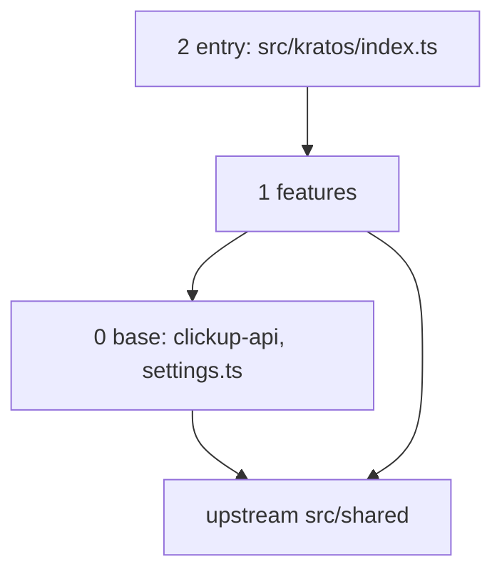

# Architecture

How code in this fork is laid out, and how it lives next to the upstream project `hauptsacheNet/clickup-mcp` (pinned in `UPSTREAM.json`). The CI check `architecture` enforces the import rules below; `docs/dev/playbook.md` holds the rest of the development rules.

> **Scope: our rules judge our code only.** Upstream code follows upstream's structure and cannot be judged by the rules in this file. These rules apply to exactly two things: our code in `src/kratos/**`, and the seams where our code meets upstream, which are the seam importers named in `.github/scripts/settings.ts` (`UPSTREAM_SEAM_IMPORTERS`, today `src/index.ts`) and the rows of `UPSTREAM-PATCHES.md`. The `architecture` check never fails on an upstream file: an upstream-only file passes whatever it imports, and a test in `.github/scripts/__tests__/architecture.test.ts` proves it.

## 1. Two kinds of code

| Code | Where | Whose rules |
|---|---|---|
| Upstream | `src/tools/`, `src/resources/`, `src/shared/`, `src/tests/`, `src/*.ts` | Upstream's own structure, kept as it is |
| Ours | `src/kratos/**` | This file |

Upstream files are never restructured, moved or reformatted to fit our rules, because every such edit would conflict on the next upstream sync. The `architecture` check never flags an upstream-only file, so an upstream sync PR stays green.

## 2. Layers in `src/kratos/`

A file imports only from its own module or from a lower layer.

| Layer | Name | Holds |
|---|---|---|
| 0 | base | `src/kratos/clickup-api/` (HTTP calls, errors, tool results) and `src/kratos/settings.ts` |
| 1 | features | one folder per feature: `src/kratos/<feature>/` |
| 2 | entry | `src/kratos/index.ts`, which registers every feature with the MCP server |

An arrow means "may import".



- Features never import each other. Code two features need moves down into the base layer.
- The base layer never imports a feature or the entry file.
- `src/kratos/` holds only `index.ts`, `settings.ts`, module folders and `tests/`.

## 3. A module

- One module is one folder under `src/kratos/`.
- Its `index.ts` is the contract: what it exports is all other modules may use. Code outside the folder imports only `index.ts`, never a file inside it.
- Constants live in the module's `settings.ts`, or in `src/kratos/settings.ts` when several modules share them.

## 4. Coexistence with upstream

- Our edits to upstream files are minimal hook or registration lines. Each is a row in `UPSTREAM-PATCHES.md`, added in the PR that makes the edit.
- Upstream code imports nothing from `src/kratos/` except through those registration lines. Today the only one is `src/index.ts`, which imports `src/kratos/index.ts` and calls `registerKratosToolsRead` and `registerKratosToolsWrite`.
- `src/kratos/` may import the upstream helpers in `src/shared/`. It never imports `src/tools/`, `src/resources/` or the root `src/*.ts` files, because those change shape between upstream releases.
- Tests are exempt from the import rules: a test under `src/kratos/**/tests/` may import any file it checks, upstream tools included.

## 5. Limits

| Limit | Value | Enforced by |
|---|---|---|
| File length in our paths | 1000 lines | `file-size` step of the `kratos` job |
| Comment block in our paths | 3 lines | `comment-length` step of the `kratos` job |
| CODE lines per PR | 400 | `pr-size` step of the `kratos` job |

A comment says why, in one line by default. The code says what; history belongs in the commit and the PR.

## 6. The `architecture` check

`.github/scripts/architecture/cli.ts` reads every tracked `src/**/*.ts` file and judges each import edge that starts or ends in `src/kratos/`. It reports:

| Rule | Example |
|---|---|
| `upstream-into-kratos` | `src/tools/task-tools.ts` imports `../kratos/list-by-status` |
| `kratos-into-upstream` | `src/kratos/clickup-api/request.ts` imports `../../tools/task-tools` |
| `module-internals` | `src/kratos/a/x.ts` imports `../b/y` instead of `../b` |
| `sideways` | feature `a` imports feature `b` |
| `upward` | `src/kratos/clickup-api/x.ts` imports a feature |
| `outside-module` | a feature file sits directly in `src/kratos/` |

Today's known violations sit in `.github/scripts/architecture/baseline.json`, each with a reason. A violation not in the baseline fails the check; a baseline entry that no longer occurs is printed as stale and should be removed. Adding an entry needs its reason in the PR.

The job runs on every PR and every push to `main`, docs-only PRs included, so it is green rather than skipped and can be a required check. Run it locally with:

```sh
bun .github/scripts/architecture/cli.ts
```
